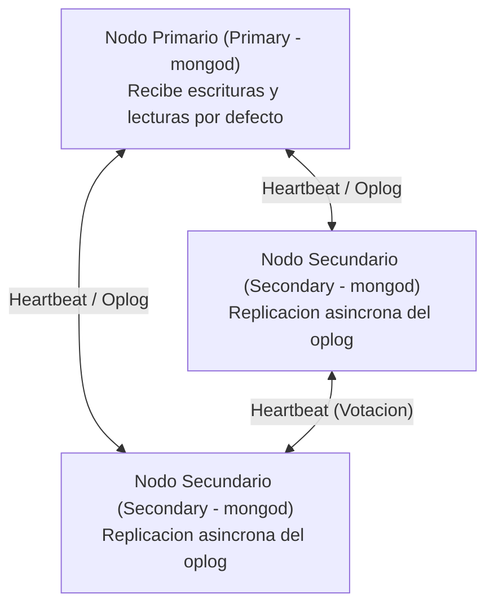
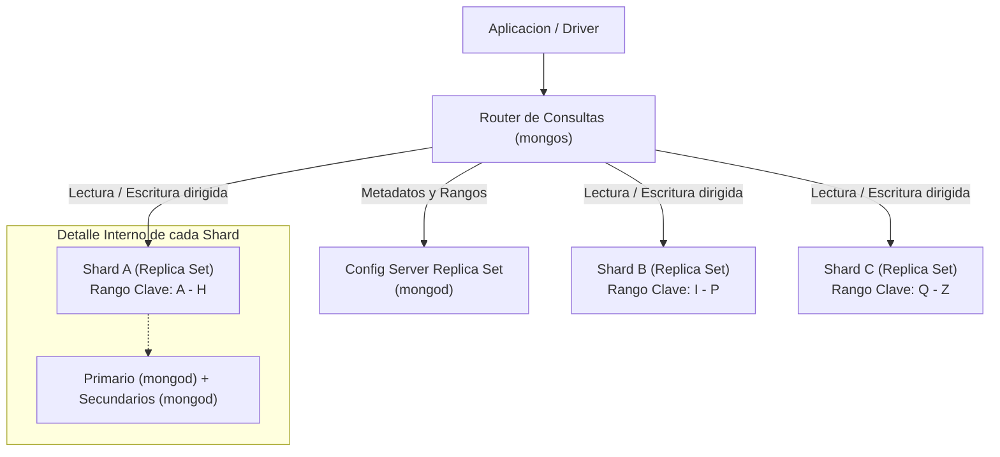
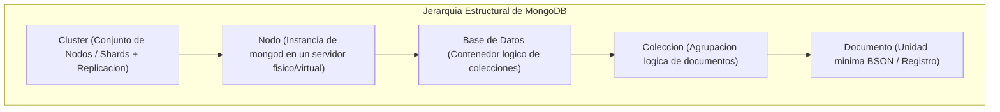

# Conceptos Fundamentales de MongoDB y Bases de Datos Orientadas a Documentos


Guia conceptual de introduccion a MongoDB: que es, representacion de datos (JSON vs BSON), caracteristicas esenciales de los motores NoSQL orientados a documentos, jerarquia estructural y posicionamiento en el Teorema CAP.

---

## Indice de Contenido

- [1. Que es MongoDB](#1-que-es-mongodb)
- [2. Representacion de Datos: JSON vs BSON](#2-representacion-de-datos-json-vs-bson)
  - [Por que BSON en lugar de JSON puro](#por-que-bson-en-lugar-de-json-puro)
  - [Tipos de Datos Adicionales en BSON](#tipos-de-datos-adicionales-en-bson)
- [3. Caracteristicas Principales](#3-caracteristicas-principales)
  - [Base de Datos Distribuida: Tipos de Clusters (Replica Set vs Sharded Cluster)](#base-de-datos-distribuida-tipos-de-clusters-replica-set-vs-sharded-cluster)
  - [Datos Polimorficos](#datos-polimorficos)
  - [Esquema Flexible (Schemaless / Dynamic Schema)](#esquema-flexible-schemaless--dynamic-schema)
- [4. Arquitectura y Jerarquia de Componentes (Piramide Estructural)](#4-arquitectura-y-jerarquia-de-componentes-piramide-estructural)
  - [Desglose Nivel por Nivel](#desglose-nivel-por-nivel)
  - [Mapeo Conceptual: Relacional (SQL) vs MongoDB](#mapeo-conceptual-relacional-sql-vs-mongodb)
- [5. Teorema CAP y MongoDB](#5-teorema-cap-y-mongodb)
  - [Los Tres Pilares del Teorema CAP](#los-tres-pilares-del-teorema-cap)
  - [Donde se Ubica MongoDB: Sistema CP](#donde-se-ubica-mongodb-sistema-cp)
  - [Ajuste de Consistencia en Clientes (Write Concern y Read Concern)](#ajuste-de-consistencia-en-clientes-write-concern-y-read-concern)

---

## 1. Que es MongoDB

MongoDB es un sistema de gestion de bases de datos no relacional (**NoSQL**), de codigo abierto y orientado a **documentos**, disenado especificamente para ofrecer alta disponibilidad, escalabilidad horizontal nativa y flexibilidad en el modelado de datos.

A diferencia de los motores relacionales tradicionales basados en tablas, filas y columnas rigidas, MongoDB almacena la informacion como documentos autodescriptivos e independientes que pueden anidar estructuras complejas (arreglos, subdocumentos) sin requerir operaciones costosas de `JOIN` en tiempo de consulta.

---

## 2. Representacion de Datos: JSON vs BSON

En la interfaz externa (APIs, controladores, shell `mongosh`, vistas), los desarrolladores interactuan con MongoDB utilizando objetos con sintaxis **JSON** (*JavaScript Object Notation*). Sin embargo, internamente en disco y en el protocolo de red, MongoDB opera con **BSON** (*Binary JSON*).

### Por que BSON en lugar de JSON puro

JSON es un formato de texto plano ligero y legible para humanos, pero presenta dos deficiencias graves para un motor de base de datos de alto rendimiento:

1. **Eficiencia en Espacio y Velocidad de Recorrido (*Traversal*):**
   - En texto JSON, para saber la longitud de un string o saltar un subobjeto, el motor debe parsear caracter por caracter (buscando llaves `{}` o comillas `"`).
   - En BSON, cada elemento va precedido por su longitud en bytes y un identificador de tipo. Esto permite al motor realizar lecturas selectivas y saltar campos sin parsear el documento completo en memoria.
2. **Tipado Estricto:**
   - JSON solo reconoce tipos primitivos basicos: `string`, `number` (sin distinguir entero de flotante), `boolean`, `null`, `array` y `object`.
   - BSON extiende el estandar con tipos de datos nativos indispensables para bases de datos profesionales.

### Tipos de Datos Adicionales en BSON

| Tipo BSON | Descripcion | Equivalente en JSON Puro |
| :--- | :--- | :--- |
| **`ObjectId`** | Identificador unico de 12 bytes generado por omision para `_id` (incluye timestamp, id de maquina, id de proceso y contador). | String simple sin metadatos. |
| **`Date`** | Marca de tiempo entera de 64 bits (milisegundos desde la epoca Unix en UTC). | String formateado ISO-8601. |
| **`Int32` / `Int64`** | Enteros firmados de 32 y 64 bits diferenciados de valores decimales. | Tipo generico `number`. |
| **`Decimal128`** | Precision decimal de 128 bits basada en IEEE 754-2008 (esencial para calculos financieros y monedas sin perdida de redondeo). | No soportado nativamente. |
| **`BinData`** | Arreglos binarios puros (ej. firmas criptograficas, hashes, imagenes pequenas). | Requiere codificacion Base64 en texto. |

---

## 3. Caracteristicas Principales

### Base de Datos Distribuida: Tipos de Clusters (Replica Set vs Sharded Cluster)

MongoDB no fue concebida como un motor para un único servidor aislado, sino como una **base de datos distribuida nativa**.

> [!NOTE]
> **¿Qué es `mongod`?**  
> `mongod` (*Mongo Daemon*) es el **proceso demonio principal del servidor** en el ecosistema de MongoDB. Es el motor en segundo plano que gestiona las peticiones de datos, administra el acceso y almacenamiento físico en disco (a través del motor de almacenamiento WiredTiger), asigna memoria caché, atiende conexiones de red y realiza tareas administrativas internas. Todo nodo dentro de un Replica Set o Shard es, en su núcleo, una instancia activa de `mongod`.

Para responder a dos necesidades operativas distintas (resistencia a fallos y crecimiento masivo de datos), MongoDB define **dos tipos fundamentales de clusters**:

#### 1. Replica Set (Conjunto de Réplicas)
- **Objetivo Principal:** **Alta Disponibilidad (HA)** y redundancia de datos.
- **Topología Mínima Recomendada:** 3 nodos (`1 Primario + 2 Secundarios`).



- **Mecánica de Funcionamiento:**
  - **Nodo Primario (*Primary*):** Es el único nodo del set que acepta operaciones de escritura (`insert`, `update`, `delete`) y lecturas por defecto. Todos los cambios se registran secuencialmente en su log de operaciones (**oplog**).
  - **Nodos Secundarios (*Secondaries*):** Instancias de `mongod` que leen y aplican el *oplog* del primario de forma asíncrona para mantener copias idénticas de la información.
  - **Failover Automático (Elección de Líder):** Si el nodo primario sufre una caída o pierde conectividad con la red, los nodos secundarios detectan la pérdida de pulso (*heartbeat*) y realizan una votación democrática en segundos para promover a uno de ellos como nuevo Primario, sin intervención manual de un administrador.

#### 2. Sharded Cluster (Clúster Fragmentado / Particionado)
- **Objetivo Principal:** **Escalabilidad Horizontal (*Scale-Out*)** de almacenamiento y procesamiento cuando el volumen de datos o la tasa de operaciones supera la capacidad física (RAM, CPU, disco) de un solo servidor o Replica Set.



- **Componentes Arquitectónicos:**
  - **Shards (Fragmentos):** Cada shard almacena una fracción o subconjunto exclusivo de los datos de la colección. En producción, **cada Shard es en sí mismo un Replica Set** (múltiples instancias `mongod`) para no comprometer la alta disponibilidad.
  - **`mongos` (Query Router):** Proceso enrutador que actúa como intermediario transparente entre la aplicación y los shards. La aplicación se conecta a `mongos` como si fuera un MongoDB normal; `mongos` analiza la consulta y la dirige únicamente al shard (o shards) que posee los datos requeridos.
  - **Config Servers (Servidores de Configuración):** Almacenan los metadatos y la cartografía del clúster (qué rangos de datos residen en qué shard específico). También se despliegan como un Replica Set para garantizar consistencia absoluta.

| Criterio | Replica Set | Sharded Cluster |
| :--- | :--- | :--- |
| **Problema que resuelve** | "¿Qué pasa si se quema el servidor?" (Disponibilidad / Fallos) | "¿Qué pasa si mis datos ya no caben en un disco o la RAM está saturada?" (Volumen / Throughput) |
| **Distribución de datos** | Cada nodo tiene una copia **completa (100%)** de los datos. | Los datos se dividen en **porciones (chunks)** repartidas entre varios shards. |
| **Complejidad operativa** | Baja / Media (3 nodos estándar). | Alta (requiere routers `mongos`, Config Servers y múltiples Replica Sets). |
| **Punto de conexión de la App** | Conexión directa a los nodos del Replica Set. | Conexión exclusiva a través del enrutador `mongos`. |

### Datos Polimorficos

En MongoDB, los documentos pertenecientes a una misma coleccion no estan obligados a poseer exactamente la misma estructura ni los mismos campos:

- Un documento puede tener 3 campos y otro 10 campos.
- Un campo puede almacenar un valor escalar en un documento y un subobjeto estructurado en otro.
- Esta caracteristica permite modelar escenarios del mundo real con multiples subtipos sin tablas intermedias (por ejemplo: una coleccion `notificaciones` donde una alerta por email incluye `asunto` y `cuerpo_html`, mientras que una alerta por SMS incluye `numero_celular` y `longitud_caracteres`).

### Esquema Flexible (Schemaless / Dynamic Schema)

El esquema evoluciona a la velocidad del codigo de la aplicacion:

- No se requiere ejecutar sentencias `ALTER TABLE` que bloqueen lecturas o escrituras durante migraciones.
- Se pueden anadir nuevos atributos a nuevas versiones de documentos sin alterar retroactivamente los registros historicos existentes.
- *Nota de control:* Aunque el esquema es dinamico por definicion, MongoDB permite aplicar reglas de validacion estricta opcionales mediante **JSON Schema Validation** a nivel de coleccion cuando el negocio exige integridad formal.

---

## 4. Arquitectura y Jerarquia de Componentes (Piramide Estructural)

La organizacion de los datos en MongoDB se estructura de lo particular (la unidad minima de almacenamiento) a lo macro (el cluster distribuido):



### Desglose Nivel por Nivel

1. **Documento (Base de la Piramide):**
   - Es la unidad basica de datos en MongoDB.
   - Equivale a un registro o fila en SQL.
   - Se estructura como pares clave-valor en BSON (limite maximo fisico por documento: 16 MB).
   - Posee obligatoriamente un campo identificador unico `_id`.

2. **Coleccion:**
   - Agrupacion logica de documentos (equivalente a una tabla en bases de datos relacionales).
   - No impone un esquema rigido por defecto a los documentos que contiene.

3. **Base de Datos:**
   - Contenedor logico que aloja un conjunto de colecciones relacionadas.
   - Cada base de datos posee su propio conjunto de archivos de almacenamiento, configuraciones de seguridad y privilegios de usuario.

4. **Nodo (*Node* / Instancia):**
   - Un proceso de servidor `mongod` en ejecucion sobre una maquina fisica, virtual o contenedor Docker.
   - Gestiona el motor de almacenamiento fisico (**WiredTiger** por defecto), memoria cache e indices.

5. **Cluster (Cuspide de la Piramide):**
   - Conjunto interconectado de nodos que cooperan entre si para proveer alta disponibilidad (Replica Sets) y/o distribucion horizontal de carga de lectura y escritura (Sharded Cluster con procesos `mongos` y servidores de configuracion).

### Mapeo Conceptual: Relacional (SQL) vs MongoDB

| Concepto Relacional (MySQL / PostgreSQL) | Concepto MongoDB |
| :--- | :--- |
| Base de Datos (*Database*) | Base de Datos (*Database*) |
| Tabla (*Table*) | Coleccion (*Collection*) |
| Fila / Registro (*Row / Tuple*) | Documento (*Document - BSON*) |
| Columna (*Column*) | Campo (*Field*) |
| Clave Primaria (*Primary Key*) | Campo `_id` (por defecto `ObjectId`) |
| `JOIN` relacional | Documentos embebidos / `$lookup` en aggregation |
| Transaccion ACID | Transaccion multi-documento (desde MongoDB 4.0+) |

---

## 5. Teorema CAP y MongoDB

El **Teorema CAP** (formulado por Eric Brewer) establece que en cualquier sistema distribuido de almacenamiento de datos es matematicamente imposible garantizar simultaneamente las siguientes tres propiedades ante fallos de red:

```
      C (Consistencia)
         /\
        /  \
       /    \
      /  CP  \  <-- MongoDB por defecto
     /________\
A (Disponibilidad) --- P (Tolerancia a Particiones)
```

### Los Tres Pilares del Teorema CAP

1. **C - Consistencia (*Consistency*):**
   - Todos los clientes ven exactamente los mismos datos en el mismo instante, sin importar a que nodo del cluster se conecten a leer.
2. **A - Disponibilidad (*Availability*):**
   - Cada peticion no fallida enviada a un nodo operativo recibe una respuesta valida (no error ni timeout), aunque no se garantice que contenga la version mas reciente del dato.
3. **P - Tolerancia a Particiones (*Partition Tolerance*):**
   - El sistema continua operando incluso si se producen cortes de comunicacion, perdida de paquetes o caidas de enlace de red entre los nodos del cluster.

> [!IMPORTANT]
> En redes distribuidas reales, las fallas de comunicacion son inevitables. Por lo tanto, la **Tolerancia a Particiones (P)** es un requisito obligatorio. Todo sistema distribuido debe elegir entre **Consistencia (CP)** o **Disponibilidad (AP)** durante una particion.

### Donde se Ubica MongoDB: Sistema CP

Por diseno por defecto, MongoDB se clasifica como un sistema **CP (Consistente y Tolerante a Particiones)**:

- **Mecanica ante particion:**  
  Un Replica Set posee un unico nodo Primario (*Primary*) que recibe todas las escrituras. Si ocurre una particion de red y el nodo Primario queda aislado de la mayoria de los nodos, este **deja de aceptar escrituras** y los nodos secundarios de la mayoria eligen un nuevo Primario mediante votacion democratica.
- **Consecuencia CAP:**  
  Durante la ventana de eleccion (que suele durar escasos segundos), el cluster **sacrifica temporalmente la disponibilidad completa de escritura (A)** para preservar la **consistencia (C)** y evitar que se escriban datos conflictivos en dos nodos distintos al mismo tiempo (*Split-Brain*).

### Ajuste de Consistencia en Clientes (Write Concern y Read Concern)

Aunque MongoDB es CP por defecto, permite a los desarrolladores flexibilizar el comportamiento segun la necesidad de cada operacion:

- **`Write Concern` (Garantia de Escritura):**
  - `w: 1` (Responde tras confirmar la escritura en el nodo Primario en memoria).
  - `w: "majority"` (Responde unicamente cuando la mayoria de los nodos de la replica han confirmado la escritura, garantizando durabilidad absoluta contra caidas).
- **`Read Concern` (Garantia de Lectura):**
  - `"local"`: Retorna el dato actual del nodo consultado (muy rapido, pero susceptible a lecturas revertidas si el primario cae antes de sincronizar).
  - `"majority"`: Retorna solo datos confirmados por la mayoria de los nodos (lectura consistente no revertible).
  - `"linearizable"`: Garantia estricta en tiempo real para aplicaciones criticas.

