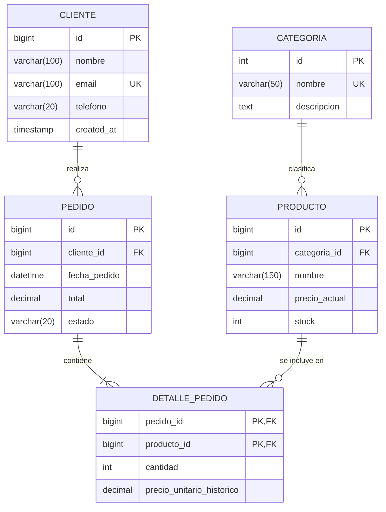

# 01. Diagrama Entidad-Relación (DER / ERD)


El **Diagrama Entidad-Relación (DER o ERD)** es la herramienta estándar de la ingeniería de software para abstraer y representar la realidad del negocio en un modelo gráfico y formal antes de escribir una sola línea de SQL.

---

## Índice

- [1. ¿Por qué es el paso previo obligatorio?](#1-por-qué-es-el-paso-previo-obligatorio)
- [2. Componentes Fundamentales de un DER](#2-componentes-fundamentales-de-un-der)
  - [Entidades (Fuertes vs Débiles)](#entidades-fuertes-vs-débiles)
  - [Atributos (Simples, Compuestos, Derivados, Multivaluados)](#atributos-simples-compuestos-derivados-multivaluados)
  - [Relaciones](#relaciones)
- [3. Notaciones: Chen vs Crow's Foot (Pata de Gallo)](#3-notaciones-chen-vs-crows-foot-pata-de-gallo)
- [4. Ejemplo Completo en Mermaid (Modelo de Negocio Real)](#4-ejemplo-completo-en-mermaid-modelo-de-negocio-real)
- [5. De Entidad Conceptual a Tabla Física en MySQL](#5-de-entidad-conceptual-a-tabla-física-en-mysql)

---

## 1. ¿Por qué es el paso previo obligatorio?

Saltar directamente a crear tablas en MySQL con `CREATE TABLE` sin un DER formal conduce a los errores más costosos de la industria:
- Descubrir relaciones circulares cuando la base de datos ya tiene datos.
- Confundir atributos con entidades (por ejemplo, guardar múltiples teléfonos en un string en vez de una relación).
- Falta de entendimiento entre el equipo de desarrollo, los arquitectos y los stakeholders de negocio.

El DER actúa como el **plano arquitectónico** del edificio: nadie construye los cimientos sin un plano aprobado.

---

## 2. Componentes Fundamentales de un DER

### Entidades (Fuertes vs Débiles)

Una **Entidad** representa un objeto real o abstracto del negocio del cual necesitamos almacenar información (ej. `Cliente`, `Vehículo`, `Factura`).

1. **Entidad Fuerte (Independiente):**
   - Posee una existencia propia y un identificador único (clave primaria natural o sustituta).
   - *Ejemplo:* `Cliente` existe por sí mismo en el sistema, tenga o no pedidos registrados.
2. **Entidad Débil (Dependiente de Existencia o Identificación):**
   - No puede existir de forma aislada; su ciclo de vida depende estrictamente de otra entidad padre.
   - *Ejemplo:* `ItemFactura` o `DetallePedido`. Si eliminas la `Factura`, los ítems pierden todo sentido existencial. Su clave primaria usualmente está compuesta por la clave de la entidad fuerte más un discriminador secuencial.

### Atributos

Son las propiedades o características que describen a una entidad:

| Tipo de Atributo | Definición | Ejemplo | Tratamiento en Modelo Relacional |
| :--- | :--- | :--- | :--- |
| **Simple / Atómico** | Indivisible por naturaleza. | `edad`, `precio`, `stock` | Columna escalar directa (`INT`, `DECIMAL`). |
| **Compuesto** | Formado por varios subcomponentes lógicos. | `direccion` (calle, ciudad, código postal) | **Debe dividirse** en columnas atómicas individuales (`calle`, `ciudad`, `codigo_postal`). |
| **Multivaluado** | Puede contener múltiples valores para la misma instancia. | `telefonos`, `habilidades` | **Antipatrón en 1NF.** Requiere extraerse a una nueva entidad relacionada (`1:N`). |
| **Derivado / Calculado** | Su valor se deduce a partir de otros atributos existentes. | `edad` (a partir de `fecha_nacimiento`) o `total` (de `subtotal + iva`) | **No debe almacenarse** físicamente (salvo casos justificados de optimización o columnas generadas `STORED`). |

### Relaciones

Es la asociación o vínculo lógico entre dos o más entidades (ej. un `Cliente` **realiza** una `Compra`).

---

## 3. Notaciones: Chen vs Crow's Foot (Pata de Gallo)

1. **Notación de Chen (Académica):** Utiliza rectángulos para entidades, rombos para relaciones y elipses para atributos. Es excelente para discusiones conceptuales pero verbosa en la práctica.
2. **Notación Crow's Foot / Pata de Gallo (Estándar de la Industria):** Representa las tablas como bloques y utiliza conectores en los extremos de las líneas para indicar simultáneamente la **cardinalidad mínima** (opcionalidad: 0 o 1) y la **cardinalidad máxima** (uno o muchos: 1 o N).

### Símbolos de Pata de Gallo

- `||`: Exactamente Uno (Obligatorio).
- `|o` u `o|`: Cero o Uno (Opcional).
- `}|`: Uno o Muchos (Obligatorio).
- `}o`: Cero o Muchos (Opcional).

---

## 4. Ejemplo Completo en Mermaid (Modelo de Negocio Real)

A continuación se muestra un DER formal en sintaxis estándar Mermaid (`erDiagram`) que modela un sistema transaccional de ventas:



> [!NOTE]
> Observa que en `DETALLE_PEDIDO` se almacena `precio_unitario_historico`. Si tomáramos el precio directamente de `PRODUCTO.precio_actual`, cambiar el precio de un producto hoy alteraría fraudulentamente el balance contable de los pedidos facturados hace un año.

---

## 5. De Entidad Conceptual a Tabla Física en MySQL

El proceso de trasladar este diseño a código ejecutable en MySQL 8.0 se rige por reglas formales:

```sql
-- Motor InnoDB para soporte transaccional ACID y Foreign Keys
CREATE TABLE categorias (
    id INT AUTO_INCREMENT PRIMARY KEY,
    nombre VARCHAR(50) NOT NULL UNIQUE,
    descripcion TEXT NULL
) ENGINE=InnoDB;

CREATE TABLE productos (
    id BIGINT AUTO_INCREMENT PRIMARY KEY,
    categoria_id INT NOT NULL,
    nombre VARCHAR(150) NOT NULL,
    precio_actual DECIMAL(12, 2) NOT NULL,
    stock INT NOT NULL DEFAULT 0,
    CONSTRAINT fk_productos_categorias 
        FOREIGN KEY (categoria_id) REFERENCES categorias(id)
        ON DELETE RESTRICT ON UPDATE CASCADE
) ENGINE=InnoDB;
```
