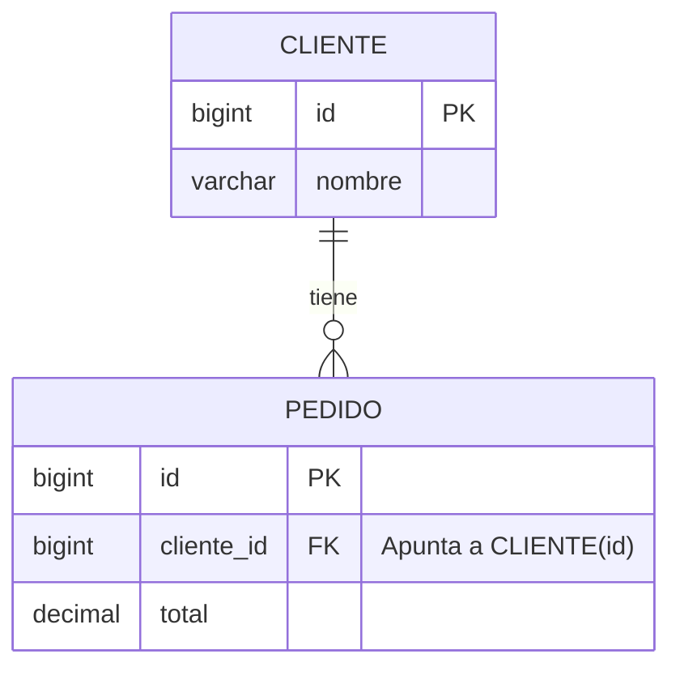
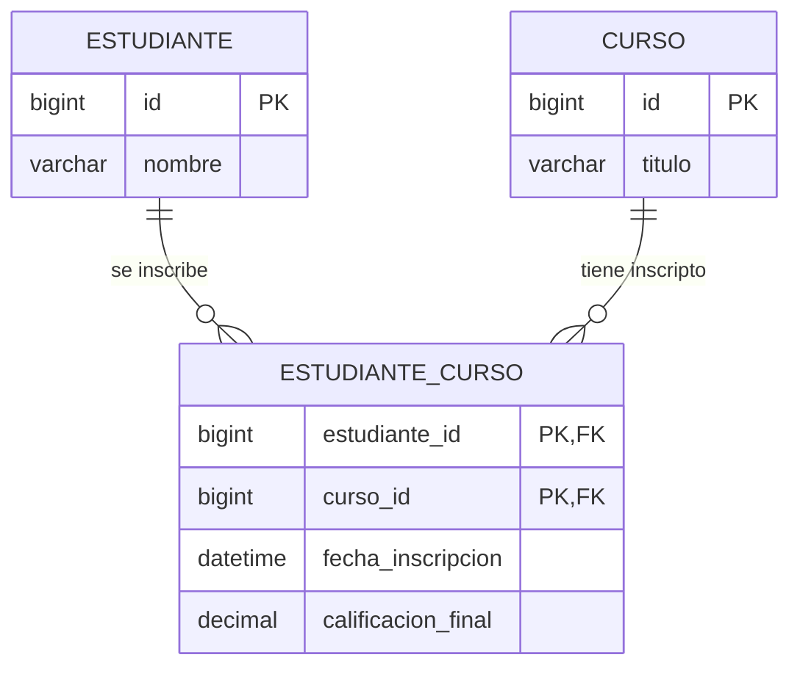

# 02. Cardinalidad y Tipos de Relaciones


La **cardinalidad** expresa cuantitativamente cómo se vinculan las instancias de una entidad con las instancias de otra. Define los límites mínimo y máximo de participación y determina la arquitectura física exacta de las tablas y claves foráneas.

---

## Índice

- [1. ¿Qué es Cardinalidad y Opcionalidad?](#1-qué-es-cardinalidad-y-opcionalidad)
- [2. Relación Uno a Uno (1:1)](#2-relación-uno-a-uno-11)
  - [¿Dónde se coloca la Clave Foránea?](#dónde-se-coloca-la-clave-foránea)
  - [Casos de Uso: Particionado Vertical y Privacidad](#casos-de-uso-particionado-vertical-y-privacidad)
- [3. Relación Uno a Muchos (1:N)](#3-relación-uno-a-muchos-1n)
  - [La Regla de Oro: La Clave Foránea siempre vive en el lado 'N'](#la-regla-de-oro-la-clave-foránea-siempre-vive-en-el-lado-n)
  - [Impacto en Rendimiento e Indexación](#impacto-en-rendimiento-e-indexación)
- [4. Relación Muchos a Muchos (N:M)](#4-relación-muchos-a-muchos-nm)
  - [Por qué N:M es Imposible Directamente en el Modelo Relacional](#por-qué-nm-es-imposible-directamente-en-el-modelo-relacional)
  - [La Tabla Asociativa (Pivote / Intermedia / Puente)](#la-tabla-asociativa-pivote--intermedia--puente)
  - [Atributos Propios de la Relación](#atributos-propios-de-la-relación)
- [5. Resumen de Decisiones de Modelado](#5-resumen-de-decisiones-de-modelado)

---

## 1. ¿Qué es Cardinalidad y Opcionalidad?

Toda relación se analiza en dos direcciones mediante dos componentes:

1. **Cardinalidad Máxima:** ¿Con cuántos registros como máximo se relaciona una fila? (Uno o Muchos).
2. **Cardinalidad Mínima (Opcionalidad):** ¿Es obligatorio que exista la relación?
   - Si la mínima es `0`, la relación es **opcional** (permite `NULL` en la clave foránea).
   - Si la mínima es `1`, la relación es **obligatoria** (la columna debe ser `NOT NULL`).

---

## 2. Relación Uno a Uno (1:1)

Un registro en la Tabla A se asocia con un único registro en la Tabla B, y viceversa.

### ¿Dónde se coloca la Clave Foránea?

Para forzar matemáticamente que la relación sea estrictamente `1:1` en el motor de base de datos, la columna que actúa como `FOREIGN KEY` debe poseer además una restricción **`UNIQUE`**.

```sql
CREATE TABLE usuarios (
    id BIGINT AUTO_INCREMENT PRIMARY KEY,
    email VARCHAR(100) NOT NULL UNIQUE,
    password_hash VARCHAR(255) NOT NULL
) ENGINE=InnoDB;

CREATE TABLE perfiles_usuario (
    id BIGINT AUTO_INCREMENT PRIMARY KEY,
    usuario_id BIGINT NOT NULL UNIQUE, -- << UNIQUE garantiza que sea 1:1 estricto
    biografia TEXT,
    avatar_url VARCHAR(255),
    CONSTRAINT fk_perfil_usuario 
        FOREIGN KEY (usuario_id) REFERENCES usuarios(id)
        ON DELETE CASCADE
) ENGINE=InnoDB;
```

### Casos de Uso: Particionado Vertical y Privacidad

¿Por qué no meter todo en una sola tabla si la relación es 1:1?
1. **Seguridad y Menor Exposición:** Separar datos sensibles de acceso restringido (ej. datos médicos, credenciales o números de tarjeta) de los datos de consulta pública cotidiana.
2. **Particionado Vertical (Optimización de Memoria en InnoDB):** Columnas muy pesadas como textos largos (`TEXT`, `BLOB`) ralentizan el escaneo de páginas de memoria de InnoDB. Al moverlas a una tabla secundaria `1:1`, la tabla principal se mantiene compacta y entran muchas más filas por página de RAM (`Buffer Pool`).

---

## 3. Relación Uno a Muchos (1:N)

Un registro en la Tabla A puede estar relacionado con múltiples registros en la Tabla B, pero cada registro en la Tabla B pertenece a uno y solo un registro en la Tabla A.

*Ejemplo clásico:* Un `Cliente` puede tener muchos `Pedidos`, pero un `Pedido` pertenece a un único `Cliente`.

### La Regla de Oro: La Clave Foránea siempre vive en el lado 'N'

> [!IMPORTANT]
> **Regla Inamovible:** La columna `FOREIGN KEY` se ubica **siempre** en la tabla hija (el lado de los **Muchos**). Si intentaras colocar el `id_pedido` dentro de la tabla `clientes`, tendrías que violar la 1NF almacenando una lista de IDs separados por coma o creando columnas repetitivas (`pedido_1`, `pedido_2`).



---

## 4. Relación Muchos a Muchos (N:M)

Un registro en la Tabla A se relaciona con múltiples registros en la Tabla B, y un registro en la Tabla B se relaciona con múltiples registros en la Tabla A.

*Ejemplos:*
- `Estudiantes` y `Cursos` (un estudiante se inscribe en varios cursos; un curso tiene varios estudiantes).
- `Artículos` y `Etiquetas` (un artículo tiene varios tags; un tag se usa en muchos artículos).

### Por qué N:M es Imposible Directamente en el Modelo Relacional

No existe ninguna forma física en una base de datos relacional de representar una relación directa N:M entre dos tablas sin romper la integridad o la normalización. 

### La Tabla Asociativa (Pivote / Intermedia / Puente)

La solución consiste en **descomponer la relación N:M en dos relaciones 1:N** mediante una tabla intermedia:



### Implementación en MySQL (Clave Primaria Compuesta)

```sql
CREATE TABLE estudiantes_cursos (
    estudiante_id BIGINT NOT NULL,
    curso_id BIGINT NOT NULL,
    fecha_inscripcion DATETIME NOT NULL DEFAULT CURRENT_TIMESTAMP,
    calificacion_final DECIMAL(4, 2) NULL,
    -- Clave primaria compuesta para evitar inscripciones duplicadas
    PRIMARY KEY (estudiante_id, curso_id),
    CONSTRAINT fk_ec_estudiante 
        FOREIGN KEY (estudiante_id) REFERENCES estudiantes(id) 
        ON DELETE CASCADE,
    CONSTRAINT fk_ec_curso 
        FOREIGN KEY (curso_id) REFERENCES cursos(id) 
        ON DELETE RESTRICT
) ENGINE=InnoDB;

-- Índice para optimizar búsquedas inversas (todos los estudiantes de un curso)
CREATE INDEX idx_ec_curso_id ON estudiantes_cursos(curso_id);
```

> [!TIP]
> Dado que la `PRIMARY KEY (estudiante_id, curso_id)` ya indexa automáticamente por `estudiante_id` en el extremo izquierdo del árbol B-Tree, **es obligatorio crear un índice explícito sobre `curso_id`** para que las consultas de búsqueda inversa sean ultrarrápidas.

---

## 5. Resumen de Decisiones de Modelado

| Tipo de Relación | ¿Dónde va la FK? | Restricción Clave | ¿Requiere Tabla Extra? |
| :---: | :---: | :---: | :---: |
| **1:1** | En cualquiera de las dos (idealmente en la entidad dependiente). | Debe ser **`UNIQUE`**. | No |
| **1:N** | **Siempre** en la tabla del lado "Muchos" (hija). | Indexada como B-Tree. | No |
| **N:M** | En una **Tabla Asociativa intermedia**. | Dos FKs que componen la PK. | **Sí (Obligatorio)** |
