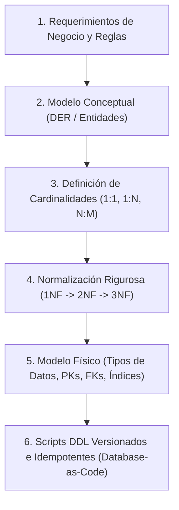

# Arquitectura, Diseño y Modelado de Bases de Datos Relacionales

> "Más del 80% de la estabilidad, operatividad, consistencia y rendimiento de un sistema depende del diseño de su base de datos. Una mala consulta SQL se optimiza en minutos con un índice; un mal diseño relacional destruye el negocio y cuesta meses de migraciones traumáticas."

Esta guía técnica desglosa la ingeniería detrás del diseño relacional formal, desde la abstracción de la realidad del negocio hasta su implementación física, garantizando la **Tercera Forma Normal (3NF)**, integridad referencial indestructible y optimización en motores relacionales modernos (MySQL 8.0+ / InnoDB).

---

## Mapa de Ruta y Módulos de la Especialidad

Cada archivo aborda una etapa crítica del ciclo de vida del modelado:

| Módulo | Documento | Enfoque Principal |
| :---: | :--- | :--- |
| **01** | [**01. Diagrama Entidad-Relación (DER / ERD)**](file:///c:/Bases%20de%20Datos/Relacionales/MySQL/diseno-y-modelado/01-diagrama-entidad-relacion.md) | **Capa Conceptual y Lógica:** Abstracción del mundo real, entidades fuertes vs débiles, atributos (simples, compuestos, derivados, multivaluados) y modelado formal con sintaxis Mermaid. |
| **02** | [**02. Cardinalidad y Tipos de Relaciones**](file:///c:/Bases%20de%20Datos/Relacionales/MySQL/diseno-y-modelado/02-cardinalidad-y-relaciones.md) | **Reglas de Negocio Estructurales:** Mecánica relacional de `1:1`, `1:N` y `N:M`. Reglas de ubicación de claves foráneas y diseño de tablas asociativas (pivote / intermedias). |
| **03** | [**03. Claves Primarias, Foráneas e Integridad Referencial**](file:///c:/Bases%20de%20Datos/Relacionales/MySQL/diseno-y-modelado/03-claves-primarias-y-foraneas.md) | **Capa Física e Integridad:** PKs sustitutas vs naturales, `AUTO_INCREMENT` vs `UUIDv4` / `UUIDv7`, impacto en árboles B-Tree, y políticas de eliminación en cascada (`RESTRICT` vs `CASCADE` vs `SET NULL`). |
| **04** | [**04. Normalización, Formas Normales y Anomalías**](file:///c:/Bases%20de%20Datos/Relacionales/MySQL/diseno-y-modelado/04-normalizacion-y-anomalias.md) | **Consistencia Matemática:** Eliminación de anomalías de inserción, borrado y actualización. Desglose riguroso de 1NF, 2NF, 3NF, BCNF y criterios profesionales para desnormalización controlada (OLTP vs OLAP). |

---

## Flujo Metodológico de Diseño (De Negocio a SQL)

---

## Principios No Negociables de Diseño

1. **Database-as-Code:** Todo cambio en la estructura debe nacer de scripts DDL versionados o migraciones reproducibles. Queda prohibido alterar esquemas en producción mediante clics en interfaces gráficas.
2. **Integridad en el Motor, no solo en la App:** Si una regla es fundamental (ej. un email único, un saldo no negativo o una relación padre-hijo), debe forzarse mediante `PRIMARY KEY`, `FOREIGN KEY`, `UNIQUE` o `CHECK` constraints en el motor de base de datos. Las aplicaciones fallan o cambian; la base de datos es la última guardiana de la verdad.
3. **Normalizado por defecto (3NF):** Todo esquema transaccional (OLTP) debe nacer en 3NF. Solo se desnormaliza con métricas de rendimiento en mano y de manera consciente.
4. **Indexación de Claves Foráneas:** Toda columna que participe como `FOREIGN KEY` debe poseer un índice B-Tree para evitar escaneos completos de tabla (*Full Table Scans*) en operaciones de JOIN y validaciones referenciales.
